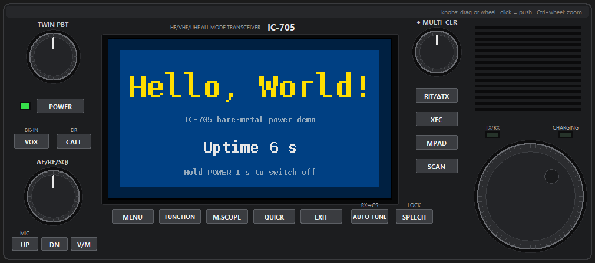

# IC-705 firmware emulator

Run the unmodified Icom IC-705 firmware in QEMU: the main CPU (Renesas
RZ/A1H, Cortex-A9) and the front-panel sub-CPU (STM32L0, Cortex-M0+) each run
their own firmware from the official update package, side by side in virtual
time. The firmware boots to its normal main screen and you use it through an
emulated front panel: touch LCD, keys, knobs, main dial, POWER and LEDs.



The firmware is never patched. Everything it talks to is modelled in the
emulator instead: GPIO, SPI, I2C EEPROM, timers, the LCD controller, the touch
panel, the sub-CPU link, the DSP and FPGA handshakes, the Wi-Fi module and the
GNSS receiver.

No Icom firmware is included. You download the update package from Icom
yourself; the launcher decodes it locally.

## What works

- Boot to the main screen, spectrum scope, menus, touch UI, all front-panel
  keys and knobs, main dial
- Power on and off with the POWER key, including deep standby and wake-up.
  A long press reaches deep standby in ~7 s.
- The POWER, TX/RX and CHARGING LEDs, driven by the sub-CPU firmware
- Settings persist in an emulated 2 Mbit EEPROM between sessions
- Wi-Fi module (TI SimpleLink) and GNSS receiver answer the firmware's
  control traffic, so it sees no errors. No networking, no position fix.

Not emulated: RF, audio, the DSPs' signal processing (their version
handshakes are answered), the FPGA's logic, Bluetooth, the SD card.

## Speed

Wall-clock time from POWER to the screen, one instance running:

| Host | LCD lit | Main screen | Idle main screen |
|---|---|---|---|
| Raspberry Pi 5 (8 GB), headless | ~4.5 s | ~10 s | 0.74× real time |
| Laptop, i7-1185G7, WSL2 | 6–7 s | 14–16 s | 0.53× real time |
| Stock QEMU `-icount`, same laptop | ~150 s | >150 s | 0.05× real time |

Power-off by long press reaches deep standby ~7 s after the press (3 s of
that is holding the key). The Pi is the fastest host we have tried; see
[Run on a Raspberry Pi](#run-on-a-raspberry-pi-show-it-on-windows).
[docs/speed.md](docs/speed.md) explains each speed-up.

## Build on Ubuntu or Windows with WSL2

```sh
sudo apt install build-essential git ninja-build pkg-config python3-venv \
  libglib2.0-dev libpixman-1-dev libgtk-3-dev libfdt-dev
bash build-qemu.sh
```

The build script downloads QEMU v11.1.1, applies `qemu/patches/`, links
`qemu/machine/` into `hw/arm/` and builds `qemu-system-arm` under
`~/ic705-qemu`. Re-run it after changing anything under `qemu/`; it rebuilds
incrementally. Build on the Linux file system: building on `/mnt/c` is very
slow. `IC705_QEMU_SOURCE` picks another build directory; pass the binary to the
launcher with `--qemu`.

## Get the firmware

Download the E-region 1.40 package from
[Icom](https://www.icomjapan.com/support/firmware_driver/4422/), extract
`705E140.dat` and put it in `firmware/` (git ignores that directory).

## Run

```sh
python3 ic705.py firmware/705E140.dat
```

From PowerShell: `wsl python3 ic705.py firmware/705E140.dat`.

A GTK window shows the LCD. Click it to touch; the wheel or the left/right
arrows turn the main dial; `m` MENU, `f` FUNCTION, `q` QUICK, `s` M.SCOPE,
`x` or Esc EXIT, `p` POWER. Close the window to end the session.

The launcher decodes the package into
`${XDG_STATE_HOME:-~/.local/state}/ic705/<hash>/`, which also holds the EEPROM.
`--prepare` only decodes. `--screenshot lcd.png --seconds 60` runs headless
and saves the LCD. `--vnc N` serves the LCD over VNC on display N, with QMP on
port 4400+N, both on 127.0.0.1.

## Run on a Raspberry Pi, show it on Windows

A Raspberry Pi 5 runs the emulator faster than a laptop under WSL2, and
`ic705_remote.py` shows it on Windows as a full front panel. The Pi needs no
screen.

**On the Pi** (Raspberry Pi OS or Debian, 64-bit):

```sh
sudo apt install build-essential git ninja-build pkg-config python3-venv \
  libglib2.0-dev libpixman-1-dev libgtk-3-dev libfdt-dev
git clone https://github.com/va3bpf/ic-705-emu ~/ic705-emu
cd ~/ic705-emu
bash build-qemu.sh
# copy 705E140.dat into ~/ic705-emu/firmware/
python3 ic705.py firmware/705E140.dat --prepare
```

**On Windows**, with Python 3 from python.org (it includes Tk) and the
built-in OpenSSH client, set up an ssh key once so no password is asked:

```bat
ssh-keygen -t ed25519
type %USERPROFILE%\.ssh\id_ed25519.pub | ssh user@raspberrypi.local "cat >> ~/.ssh/authorized_keys"
```

Then, in this repository:

```bat
python ic705_remote.py --host user@raspberrypi.local
```

The script logs in with ssh, starts `ic705.py --vnc 11` on the Pi and
forwards the LCD (VNC), control (QMP) and serial-log ports through the same ssh
connection. All three listen only on the Pi's 127.0.0.1. `--dir` and `--firmware`
set the paths on the Pi. The window opens at 1:1. Ctrl+wheel or Ctrl +/- zoom
from 0.5× to 4×, Ctrl+0 returns to 1:1, and dragging the window edge picks
the largest zoom that fits.

The same window also runs the emulator on this computer: `--host local`
starts it in WSL on Windows (or directly on Linux), with no ssh.

**Loader.** `python ic705_remote.py` without arguments opens two windows:
the loader and, once something runs, the front panel it owns. In the loader
choose the firmware (a local `.bin` or `.dat`, uploaded first for a remote
host, or a path on the host), Local (WSL on Windows, or directly on Linux)
or Remote (host, user, and a password or empty for your ssh key), and
whether Icom's sub-CPU runs beside your `.bin`. Start/Stop, Restart (F5,
after a rebuild) and Screenshot are there too. Every change is saved at
once in `~/.ic705_remote.json` (the password encrypted with Windows DPAPI)
and used at the next start; a saved firmware starts by itself.

Closing the panel window only hides it, and "Show panel" brings it back;
Stop ends the emulator; closing the loader ends everything. The fold-out
"Serial log" shows what the firmware writes to SCIF0/SCIF1 (TCP port 4500+N
on the emulator host, forwarded through the same ssh connection); see
[examples/lvgl](examples/lvgl/README.md#debug-log).

### Front panel

The panel follows the radio's layout. Every control drives the input the
firmware reads:

| Control | Input |
|---|---|
| LCD | TSC2046 touch panel (click and drag); wheel on the LCD turns the main dial |
| MENU, FUNCTION, M.SCOPE, QUICK, EXIT, AUTO TUNE, SPEECH, VOX, CALL, RIT/ΔTX, MPAD, SCAN | sub-CPU ADC key ladders, held while the mouse button is held |
| XFC | sub-CPU PC15 (XFCK), low while held |
| TWIN PBT, AF/RF/SQL, MULTI | port-8 quadrature encoders: drag or wheel to turn, click to push |
| Main dial | MTU2 ch1 phase counting, 10 Hz per count |
| MIC UP, DN, V/M | ARM ADC ch6 ladder |
| POWER | PWRK = P8_7, low while pressed. A short press wakes the radio; a long press turns it off. |
| POWER, TX/RX, CHARGING LEDs | RZ P10_3 (PWRDS), sub-CPU PA12 TDS (red) / PA11 RDS (green), RZ P10_5 (BATTDS); see [docs/ic705/IO_MAP.md](docs/ic705/IO_MAP.md) |

AUTO TUNE is placed by elimination; with no tuner connected it shows
nothing. PTT is not on the panel.

## Your own firmware

`examples/` holds bare-metal programs for the main CPU, built with
`arm-none-eabi-gcc` into flat images that boot at 0x18000000:

- `examples/hello`: draws Hello, World! into a frame buffer and shows it
  on VDC5 graphics plane GR0.
- `examples/power`: starts in deep standby, powers on when POWER (PWRK) is
  pressed, shows Hello, World! with an uptime counter, and goes back to deep
  standby after a 1 s hold of POWER. Like the Icom firmware it raises PWRS
  (P7_15, supply rails) and PWRDS (P10_3, the POWER LED) while on.
- `examples/lvgl`: a starting point for third-party firmware: FreeRTOS
  tasks and an LVGL user interface on the touch screen, tuned with the
  main dial. See [examples/lvgl/README.md](examples/lvgl/README.md).

```sh
sh examples/power/build.sh
python3 ic705.py examples/power/power.bin        # local GTK window, `p` = POWER
```

A `.bin` runs on the IC-705 board, so POWER, touch, the knobs and the main
dial reach it. `--subcpu` adds the sub-CPU firmware from an Icom package
(panel keys, LEDs); both CPUs then run under `-icount`. `ic705_remote.py
--load FILE` sends a local `.bin` or `.dat` to the remote host and runs it
there (add `--subcpu` for the sub-CPU from `--firmware`):

```bat
python ic705_remote.py --host user@raspberrypi.local --load examples/power/power.bin
```

## What to expect

- The LCD stays black for a few seconds, then the boot splash
  (ICOM / IC-705 / 1.40) appears, then the main screen.
- A new EEPROM starts in Japanese. Change it once:
  MENU > SET > Display > System Language > English.
- If a session ended without powering off, the EEPROM remembers the radio as
  on and the firmware powers up by itself. The launcher detects this and skips
  its POWER press.
- `RZA1H_IC705_DSP_READY=off`, `RZA1H_IC705_DV_READY=off`,
  `RZA1H_IC705_WLAN=off` and `RZA1H_IC705_GPS=off` switch the respective
  device models off, to see how the firmware reacts without them.
- Run one instance at a time: each uses a full core.

## Layout

| Path | Contents |
|---|---|
| `ic705.py` | Launcher: decodes the firmware package, starts QEMU, presses POWER |
| `ic705_remote.py` | Front-panel window for an emulator running on another host |
| `build-qemu.sh` | Downloads QEMU, applies the patches, builds `qemu-system-arm` |
| `qemu/machine/` | RZ/A1H machine and IC-705 device models |
| `qemu/ic705/` | Device models written by this project (IC-705 board and RZ/A1H blocks), one file per device |
| `qemu/patches/` | Changes to QEMU itself: build glue, icount and TCG speed-ups |
| `decoder/` | Icom `.dat` firmware package decoder |
| `examples/` | Programs for the main CPU: hello, power on/off, LVGL + FreeRTOS |
| `docs/` | Hardware and firmware notes ([board behaviour](docs/ic705/BOARD.md), [I/O map](docs/ic705/IO_MAP.md)), [speed history](docs/speed.md), [how the emulator works](docs/emulator.html) |
| `NOTICE.md` | Origin and licence of each part |

## Acknowledgements

This project stands on the work of others:

- **[jeskko/ic7300-homebrew](https://github.com/jeskko/ic7300-homebrew)**:
  the RZ/A1H QEMU machine that boots the IC-7300's stock firmware. The
  machine model in `qemu/machine/` starts from it.
- **[nemanjan00/ic-705](https://github.com/nemanjan00/ic-705)**: the
  first IC-705 port of that machine and the first IC-705 firmware analysis,
  which this emulator builds on. Its code is not included here.
- **[sq6emm/ic705-ic9700-ic905-bring-your-own-firmware](https://github.com/sq6emm/ic705-ic9700-ic905-bring-your-own-firmware)**:
  the `.dat` package decoder in `decoder/`.
- **[QEMU](https://www.qemu.org/)**: the emulator this all runs on.
- The IC-705 service manual's schematics, for pin assignments.

## Licence

This project's own code and documents are under the MIT licence
([LICENSE](LICENSE)). The parts from other projects keep their licences: see
[NOTICE.md](NOTICE.md). A QEMU binary built from this tree is covered by
QEMU's licence (GPL-2.0-or-later).
"Icom" and "IC-705" are trademarks of Icom Inc. This project is not affiliated
with Icom.
