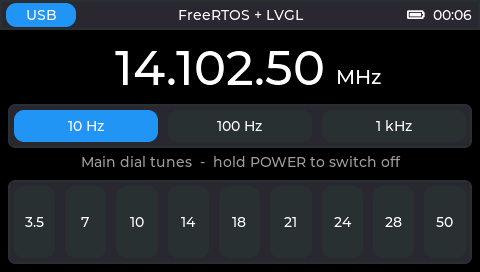

# LVGL + FreeRTOS on the IC-705

A starting point for third-party IC-705 firmware: [FreeRTOS](https://www.freertos.org/)
schedules the tasks and [LVGL](https://lvgl.io/) draws the user interface on
the 480x272 touch screen. It runs on the main CPU (RZ/A1H, Cortex-A9) from
the 16 MB SPI flash and uses the 10 MB of on-chip RAM; the radio has no
external RAM.



- Cold start: deep standby, as the Icom firmware does. POWER switches on
  (supply rails PWRS and the POWER LED PWRDS on), a 1 s hold switches off.
- The main dial tunes by the selected step; the band buttons jump to a band;
  the mode button cycles USB/LSB/CW/AM/FM.

## Build and run

```sh
sudo apt install gcc-arm-none-eabi     # or the Arm GNU toolchain
sh examples/lvgl/build.sh              # fetches LVGL v9.2.2 and FreeRTOS V11.1.0
python3 ic705_emu.py examples/lvgl/lvgl_demo.bin
python ic705_panel.py --host user@raspberrypi.local --load examples/lvgl/lvgl_demo.bin
```

In the window, `p` is POWER, the wheel is the main dial and the mouse is the
touch screen.

## Debug log

`log_printf()` (printf-style, from any task) writes to SCIF0 at 115200 8N1.
The demo logs power on/off, band, step and mode changes:

```
IC-705 LVGL demo: powered on by the POWER key
FreeRTOS V11.1.0, LVGL 9.2.2
GUI up, free heap 452976 bytes
band 7 m: 7074000 Hz
```

With `--vnc N`, ic705_emu.py puts SCIF0 and SCIF1 on TCP port 4500+N
(`nc 127.0.0.1 4511` for display 11); ic705_panel.py shows them in the
loader's "Serial log" pane, locally or through its ssh tunnel.

## How it fits together

| File | What it does |
|---|---|
| `start.S` | vectors (VBAR), mode stacks, `.data`/`.bss`, `main()` |
| `main.c` | power-on check, GIC, the 1 kHz tick on OSTM0 (interrupt 134), the GUI and power tasks |
| `display.c` | VDC5 plane GR0 shows an RGB565 frame buffer at 0x20800000; LVGL renders 40 lines at a time and copies them in |
| `touch.c` | the TSC2046 touch controller, bit-banged on port 3, as an LVGL pointer |
| `dial_power.c` | the main dial (MTU2 channel 1, phase counting) and power: PWRS, PWRDS, deep standby with PWRK as the wake-up |
| `ui.c` | the screen |
| `serial.c` | `log_printf()`: the debug log on SCIF0, polled, a mutex between tasks |
| `support.c` | `memcpy` and the few other C library functions needed; byte-wise, because with the MMU off unaligned accesses fault |
| `FreeRTOSConfig.h`, `lv_conf.h` | configuration |

Tasks: the GUI task owns every LVGL call (`lv_timer_handler` every 5 ms,
polling the dial and touch); the power task watches PWRK and asks the GUI
task to switch off.

Not done yet, and good next steps: double buffering with the frame buffer
switched at vsync, the MMU and caches (the real chip needs them for speed;
the emulator does not care), the front-panel keys (they come from the
sub-CPU over SCIF3, see docs/ic705/IO_MAP.md), the MULTI and other port-8
encoders.

Pins and devices: [docs/ic705/IO_MAP.md](../../docs/ic705/IO_MAP.md),
[docs/ic705/BOARD.md](../../docs/ic705/BOARD.md).
